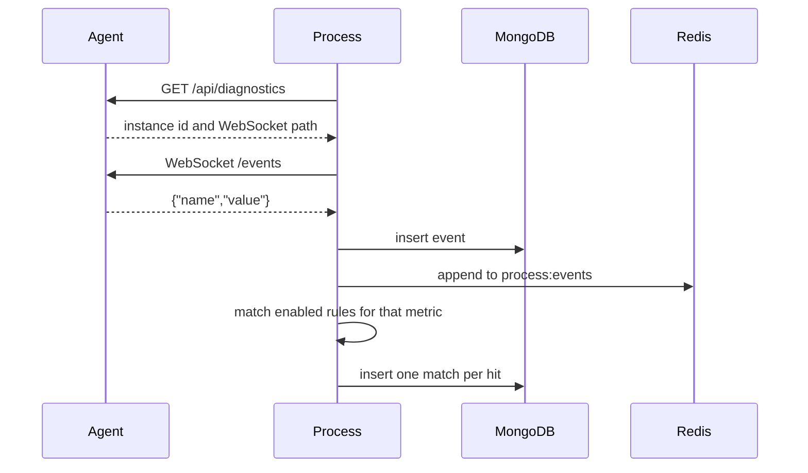

# PartAI

PartAI is a two-service telemetry stack. The **agent** publishes live numeric samples. The **process** service stores every sample, evaluates rules, and keeps a record of each match.

An event is only a metric name and a number:

```json
{"name":"temperature","value":91.2}
```

The agent does not know about thresholds. Rules live in the process service. Each running agent has a short id (`k7m2qx` in this compose file). The process service reads that id from the agent and stores it with every event and every match.

## Contents

- [Architecture](#architecture)
- [Requirements](#requirements)
- [Run with Docker Compose](#run-with-docker-compose)
- [Configuration](#configuration)
- [How one sample moves](#how-one-sample-moves)
- [Metrics](#metrics)
- [Rules](#rules)
- [Agent API](#agent-api)
- [Process API](#process-api)
- [Stored data](#stored-data)
- [Run on the host](#run-on-the-host)
- [Tests](#tests)
- [Repository](#repository)

## Architecture

```text
agent :3000                         process :3001
  generates samples                   subscribes over WebSocket
  WebSocket /events          ----->   stores events in MongoDB
  SSE  /api/events/stream             appends process:events in Redis
  HTTP /api/events                    evaluates enabled rules in memory
                                      writes one match per hit
        |                                    |
        |                         MongoDB :27017    Redis :6379
        |                         events            stream process:events
        |                         rules             key    process:rules:active
        |                         rule_matches      channel process:rules
```

| Service | What it does | Address |
| --- | --- | --- |
| [agent](agent/README.md) | Generates samples and publishes them over WebSocket, server-sent events, and HTTP | http://localhost:3000 |
| [process](process/README.md) | Subscribes to the agent, stores events, evaluates rules, records matches | http://localhost:3001 |
| MongoDB | Durable store for events, rules, and matches | `mongodb://localhost:27017/process` |
| Redis | Bounded event stream and a shared copy of the enabled rules | `redis://localhost:6379` |

Interactive API docs for the process service: http://localhost:3001/api/docs

Both HTTP APIs use the global prefix `/api`. Unknown JSON fields are rejected. The agent adds `X-Agent-Instance-Id` to every HTTP response and exposes that header to browsers.

## Requirements

- Docker Engine with Compose v2, for the full stack
- Node.js 24, only when running a service on the host or running tests

The Docker images are `node:24-bookworm-slim`. Each image builds with `npm ci`, then runs `node dist/main.js` as the `node` user.

## Run with Docker Compose

`docker-compose.yml` starts MongoDB, Redis, the agent, and the process service. The process service waits until the other three are healthy.

```bash
docker compose up --build
```

Then:

| URL | What you should see |
| --- | --- |
| http://localhost:3000/api/diagnostics | Agent id `k7m2qx`, publish counters, and metric names |
| http://localhost:3001/api/status | `"connected": true` and the number of active rules |
| http://localhost:3001/api/rules | Ten sample rules. Nine are enabled |
| http://localhost:3001/api/matches | Rules that have already fired |
| http://localhost:3001/api/docs | Swagger UI for the process API |

Stop the stack with `docker compose down`. Named volumes `mongo-data` and `redis-data` keep MongoDB and Redis data across restarts. `docker compose down -v` deletes that data.

Health checks:

| Service | Probe | Interval | Start period |
| --- | --- | --- | --- |
| mongo | `mongosh` admin ping | 5s | 10s |
| redis | `redis-cli ping` | 5s | 5s |
| agent | `GET http://127.0.0.1:3000/api/diagnostics` | 10s | 20s |
| process | `GET http://127.0.0.1:3001/api/status` | 10s | 20s |

Published ports are `27017`, `6379`, `3000`, and `3001`. Inside the Compose network the process service uses `mongodb://mongo:27017/process`, `redis://redis:6379`, and `http://agent:3000`.

## Configuration

Compose sets these variables. Host defaults live in [agent/.env.example](agent/.env.example) and [process/.env.example](process/.env.example). Copy each example to `.env` in that service directory before `npm run start:dev`.

### Agent

| Variable | Compose / default | Allowed | Meaning |
| --- | --- | --- | --- |
| `AGENT_INSTANCE_ID` | `k7m2qx` | 4–12 lowercase letters or digits | Id logged at startup, returned by diagnostics, and sent on `X-Agent-Instance-Id` |
| `PORT` | `3000` | 1–65535 | HTTP and WebSocket port |
| `EVENT_COUNT` | `5` | integer 1–100 | Samples published in each interval |
| `INTERVAL_SECONDS` | `1` | integer 1–3600 | Length of that interval, in seconds |
| `EVENT_BUFFER_SIZE` | `512` | integer 1–10000 | In-memory ring of recent events |
| `WS_PATH` | `/events` | path like `/events` | WebSocket path |
| `LOG_EVERY_SECONDS` | `30` | integer 0–3600 | Seconds between publish-stats logs. `0` disables the log |
| `MAX_BUFFERED_BYTES` | `1048576` | integer 1024–16777216 | Drop a slow subscriber while its socket buffer is above this size |
| `METRIC_DEFS` | unset | JSON array | Optional range overrides for known metric names |

`METRIC_DEFS` replaces `min`, `max`, and optional `fractionDigits` (0–8, default 2) for names that already exist. It does not add new names. Each name may appear once, and `max` must be greater than `min`.

```bash
METRIC_DEFS=[{"name":"speed","min":0,"max":180,"fractionDigits":1}]
```

### Process

| Variable | Compose value | Host default | Allowed | Meaning |
| --- | --- | --- | --- | --- |
| `PORT` | `3001` | `3001` | 1–65535 | HTTP port |
| `MONGODB_URI` | `mongodb://mongo:27017/process` | `mongodb://127.0.0.1:27017/process` | MongoDB URI | Database for events, rules, and matches |
| `REDIS_URL` | `redis://redis:6379` | `redis://127.0.0.1:6379` | Redis URL | Stream and rule cache |
| `AGENT_BASE_URL` | `http://agent:3000` | `http://127.0.0.1:3000` | absolute `http` or `https` origin | Agent the subscriber connects to |
| `REDIS_EVENT_MAXLEN` | `100000` | `100000` | integer 100–1000000 | Approximate cap on the Redis stream |

## How one sample moves



The agent keeps a short in-memory ring of recent events. It does not write samples to disk. MongoDB is the durable copy, and it has no size cap. Redis keeps a trimmed stream (`process:events`, approximate `MAXLEN`) so a slow consumer of the stream cannot grow without bound. A failed Redis write does not remove the event already stored in MongoDB.

If the WebSocket closes, the process service reads diagnostics again and reconnects. The wait starts at 500 ms and doubles up to 10 seconds.

Rule checks use an in-memory index grouped by metric. A temperature event is compared only with temperature rules. Creating, updating, or deleting a rule replaces that index and publishes the new enabled set on Redis (`process:rules`, with the JSON also stored at `process:rules:active`) so other process instances stay in step.

A match stores the agent instance id, a snapshot of the rule, and the event. Later edits or deletion of the rule leave older matches unchanged.

Each Redis stream entry has `eventId`, `agentInstanceId`, `name`, `value`, and `receivedAt`.

## Metrics

Both services use the same names. Ranges below are the agent's sample generator. They are not alert thresholds.

| Name | Generated range | Fraction digits | Unit |
| --- | --- | --- | --- |
| `speed` | 0 – 180 | 1 | km/h |
| `temperature` | −20 – 120 | 2 | °C |
| `voltage` | 0 – 240 | 2 | V |
| `noise` | 30 – 120 | 1 | dB |
| `pressure` | 900 – 1100 | 1 | hPa |
| `humidity` | 0 – 100 | 1 | % |
| `current` | 0 – 30 | 2 | A |
| `vibration` | 0 – 20 | 3 | mm/s |

## Rules

Operators:

| Operator | Match when |
| --- | --- |
| `gt` | value is greater than the threshold |
| `gte` | value is greater than or equal to the threshold |
| `lt` | value is less than the threshold |
| `lte` | value is less than or equal to the threshold |
| `eq` | value equals the threshold |
| `between` | value is inside the inclusive range `value` … `valueTo` |

A `between` rule needs `valueTo`, and `valueTo` must be greater than `value`. Every other operator stores `valueTo` as `null`. `enabled` defaults to `true`. A disabled rule stays in MongoDB and is left out of evaluation. `title` is 1–80 characters.

```bash
curl -X POST http://localhost:3001/api/rules \
  -H 'content-type: application/json' \
  -d '{"title":"High temperature","metric":"temperature","operator":"gte","value":80}'
```

The first start inserts any sample rule whose title is not already in MongoDB. A sample rule that is already stored is left as it is, including after someone has edited it. `Stopped` is inserted disabled.

| Title | Metric | Operator | Threshold | Enabled |
| --- | --- | --- | --- | --- |
| High speed | `speed` | `gt` | 120 | yes |
| Freezing | `temperature` | `lt` | 0 | yes |
| High temperature | `temperature` | `gte` | 80 | yes |
| High line voltage | `voltage` | `between` | 220 – 240 | yes |
| Loud | `noise` | `gte` | 90 | yes |
| Low pressure | `pressure` | `lte` | 980 | yes |
| High humidity | `humidity` | `gt` | 70 | yes |
| High current | `current` | `gt` | 20 | yes |
| Strong vibration | `vibration` | `gte` | 10 | yes |
| Stopped | `speed` | `eq` | 0 | no |

## Agent API

Base URL: `http://localhost:3000`. There is no Swagger page on the agent.

### `GET /api/diagnostics`

```json
{
  "instanceId": "k7m2qx",
  "uptimeMs": 12000,
  "port": 3000,
  "wsPath": "/events",
  "eventCount": 5,
  "intervalSeconds": 1,
  "published": 40,
  "subscribers": 1,
  "buffered": 40,
  "bufferCapacity": 512,
  "dropped": 0,
  "listenerErrors": 0,
  "metrics": ["speed", "temperature", "voltage", "noise", "pressure", "humidity", "current", "vibration"]
}
```

### `POST /api/events`

Publishes one sample into the same path as generated events. Responds `202` with the accepted body.

```bash
curl -X POST http://localhost:3000/api/events \
  -H 'content-type: application/json' \
  -d '{"name":"voltage","value":12.5}'
```

`name` must be one of the metric names. `value` must be a finite number.

### `GET /api/events`

Recent events from the in-memory ring, not from MongoDB.

| Query | Default | Limit |
| --- | --- | --- |
| `limit` | 100 | 1–1000 |
| `names` | all metrics | comma-separated metric names, at most 2048 characters |

```bash
curl "http://localhost:3000/api/events?limit=100&names=temperature,voltage"
```

```json
{
  "instanceId": "k7m2qx",
  "events": [{"name": "temperature", "value": 21.54}]
}
```

### `GET /api/events/stream`

Server-sent events. Optional `names` uses the same comma-separated filter. A comment line names the instance, then each sample is one `data` frame. A `: ping` comment is written every 15 seconds while the socket is idle.

```text
: instance k7m2qx

data: {"name":"temperature","value":21.54}
```

### WebSocket `ws://localhost:3000/events`

Each text frame from the server is one event:

```json
{"name":"noise","value":63.4}
```

Send a filter to receive only the metrics a subscriber cares about:

```json
{"names":["temperature","voltage"]}
```

An empty `names` list selects every metric again.

## Process API

Base URL: `http://localhost:3001`. Field-level descriptions, enums, and error bodies are in Swagger at `/api/docs`.

List endpoints share paging. `page` starts at 1 and defaults to 1. `limit` defaults to 20 and cannot be greater than 100. The response is `{ "items", "total", "page", "limit" }`.

Validation and missing-record errors use:

```json
{
  "statusCode": 400,
  "message": ["title must be longer than or equal to 1 characters"],
  "error": "Bad Request"
}
```

`message` is a string or an array of strings.

### Rules

| Method | Path | Result |
| --- | --- | --- |
| `POST` | `/api/rules` | `201` and the stored rule |
| `GET` | `/api/rules` | page, most recently updated first |
| `GET` | `/api/rules/:id` | one rule, or `404` |
| `PATCH` | `/api/rules/:id` | updated rule. Omitted fields stay as they are |
| `DELETE` | `/api/rules/:id` | `204`. Stored matches for that rule are kept |

`GET /api/rules` accepts `metric` and `enabled` (`true` or `false`).

Create body:

```json
{
  "title": "High temperature",
  "metric": "temperature",
  "operator": "gt",
  "value": 80,
  "valueTo": 100,
  "enabled": true
}
```

`valueTo` is required only for `between`. A stored rule looks like:

```json
{
  "id": "66f0c2b5e1a4c3d2b1a09876",
  "title": "High temperature",
  "metric": "temperature",
  "operator": "gte",
  "value": 80,
  "valueTo": null,
  "enabled": true,
  "createdAt": "2026-10-08T11:00:00.000Z",
  "updatedAt": "2026-10-08T11:00:00.000Z"
}
```

### Events

`GET /api/events` returns events received from the agent, newest first.

| Query | Meaning |
| --- | --- |
| `name` | one metric name |
| `agentInstanceId` | publishing agent, at most 32 characters |
| `page`, `limit` | paging |

```json
{
  "id": "66f0c2b5e1a4c3d2b1a09877",
  "agentInstanceId": "k7m2qx",
  "name": "temperature",
  "value": 91.2,
  "receivedAt": "2026-10-08T11:00:00.000Z"
}
```

`agentInstanceId` comes from the agent diagnostics response, not from the event body.

### Matches

`GET /api/matches` returns matches, newest first. Filter with `agentInstanceId`, `ruleId`, or both.

```json
{
  "id": "66f0c2b5e1a4c3d2b1a09878",
  "agentInstanceId": "k7m2qx",
  "ruleId": "66f0c2b5e1a4c3d2b1a09876",
  "rule": {
    "id": "66f0c2b5e1a4c3d2b1a09876",
    "title": "High temperature",
    "metric": "temperature",
    "operator": "gte",
    "value": 80,
    "valueTo": null
  },
  "event": {
    "id": "66f0c2b5e1a4c3d2b1a09877",
    "agentInstanceId": "k7m2qx",
    "name": "temperature",
    "value": 91.2,
    "receivedAt": "2026-10-08T11:00:00.000Z"
  },
  "matchedAt": "2026-10-08T11:00:00.000Z"
}
```

`matchedAt` is the event `receivedAt`. `rule` is a snapshot from match time.

### Status

`GET /api/status`

```json
{
  "connected": true,
  "agentInstanceId": "k7m2qx",
  "activeRules": 9
}
```

`connected` is true while the WebSocket to the agent is open. `agentInstanceId` stays `null` until the first successful diagnostics read. `activeRules` is the number of enabled rules currently in memory.

## Stored data

MongoDB database `process`:

| Collection | Contents | Useful indexes |
| --- | --- | --- |
| `events` | every accepted sample | `name` + `receivedAt`, `agentInstanceId` + `receivedAt` |
| `rules` | rule definitions, with `createdAt` and `updatedAt` | `metric` + `enabled` |
| `rule_matches` | agent id, rule id, rule snapshot, event, `matchedAt` | `ruleId` + `matchedAt`, `agentInstanceId` + `matchedAt` |

Redis:

| Key | Type | Contents |
| --- | --- | --- |
| `process:events` | stream | trimmed event log |
| `process:rules:active` | string | JSON of the enabled rules |
| `process:rules` | pub/sub channel | same JSON, published when the rule set changes |

## Run on the host

Each service can run outside Compose. Details are in [agent/README.md](agent/README.md) and [process/README.md](process/README.md).

Start databases, then the two Node processes:

```bash
docker compose up mongo redis
```

```bash
cd agent
npm install
npm run start:dev
```

```bash
cd process
npm install
npm run start:dev
```

The process service expects the agent at `http://127.0.0.1:3000`. Starting it inserts any missing sample rules, then loads the enabled ones into memory.

`npm run build` in `process`, then `npm run seed`, loads the same sample rules without starting the subscriber. The seed script is `node dist/seed/seed.js`, so the build has to exist first.

## Tests

From each service directory:

```bash
npm test
```

The agent also has `npm run test:e2e`. Lint with `npm run lint` in the service directory you changed.

## Repository

```text
docker-compose.yml    MongoDB, Redis, agent, and process
agent/                 NestJS publisher
process/               NestJS subscriber, rules, and storage
```
